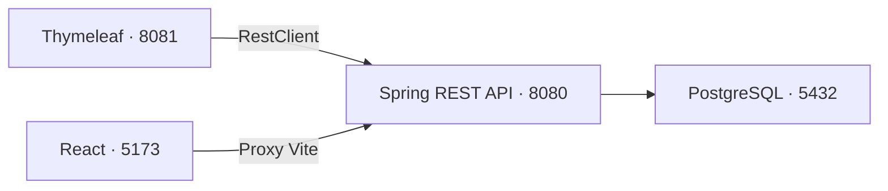

# Agile · środowisko startowe do Sprintu 1

Wybierz **Thymeleaf** albo **React**. Każdy wariant ma własny frontend i może działać samodzielnie z API w Javie i bazą PostgreSQL. Wykonaj krok 4A, jeśli masz folder `project-web-app`, lub 4B, jeśli masz folder `project-web-react`. Jeśli masz oba foldery, możesz uruchomić oba frontendy jednocześnie i porównać je w dwóch kartach przeglądarki.

Strona startowa pokazuje, czy frontend łączy się z API i czy API ma dostęp do bazy. Formularz „Nazwa projektu” i lista zapisanych projektów są zadaniami do wykonania w Sprincie 1.

## Uruchomienie krok po kroku

### 1. Przygotuj narzędzia i otwórz repozytorium

Potrzebujesz **JDK 21**, **Git** oraz **Docker Desktop** z działającym silnikiem. Do wariantu React potrzebujesz też **Node.js 22.12 lub nowszego** i npm. Gradle Wrapper pobierze potrzebną wersję Gradle przy pierwszym uruchomieniu. Na Windowsie najlepiej sklonować projekt do folderu, którego ścieżka zawiera litery bez znaków diakrytycznych, np. `D:\projekty`. [Gradle Wrapper](https://docs.gradle.org/current/userguide/gradle_wrapper.html) · [Wymagania Vite](https://vite.dev/guide/#getting-started)

**Chcesz sprawdzić kod przed scaleniem PR-a?** W PowerShellu otwórz folder, w którym chcesz umieścić projekt, i wykonaj jeden z dwóch bloków.

**React z PR-a #1**

```powershell
git clone --branch codex/backend-react https://github.com/xHajji/Agile.git Agile-react
cd Agile-react
```

**Thymeleaf z PR-a #2**

```powershell
git clone --branch codex/backend-thymeleaf https://github.com/xHajji/Agile.git Agile-thymeleaf
cd Agile-thymeleaf
```

**Po scaleniu wybranego PR-a** możesz pobrać projekt z gałęzi `main`.

```powershell
git clone https://github.com/xHajji/Agile.git
cd Agile
```

W kolejnych krokach **folder projektu** to ten, w którym jest plik `compose.yaml`. W każdym nowym terminalu wejdź do tego samego folderu. Terminale z uruchomionym API i frontendem zostaw otwarte.

### 2. Uruchom bazę PostgreSQL

Otwórz Docker Desktop i poczekaj na uruchomienie silnika. Poniższe polecenia wykonaj w pierwszym terminalu, w folderze projektu.

```powershell
docker compose up -d --wait db
docker compose ps
```

W kolumnie stanu przy `db` powinno pojawić się `healthy`. Przy pierwszym uruchomieniu Docker pobierze obraz PostgreSQL. [Dokumentacja Docker Compose](https://docs.docker.com/reference/cli/docker/compose/up/)

### 3. Uruchom wspólne API

Otwórz drugi terminal w folderze projektu i uruchom API.

```powershell
.\gradlew.bat :project-rest-api:bootRun
```

Na macOS i Linuksie użyj `./gradlew :project-rest-api:bootRun`. Zostaw terminal otwarty. Otwórz [stan API](http://127.0.0.1:8080/actuator/health). Odpowiedź powinna zawierać `"status":"UP"`. Ten wynik uwzględnia połączenie z bazą. [Spring Boot Actuator](https://docs.spring.io/spring-boot/reference/actuator/endpoints.html#actuator.endpoints.health)

### 4A. Uruchom frontend Thymeleaf

Otwórz kolejny terminal w folderze projektu.

```powershell
.\gradlew.bat :project-web-app:bootRun
```

Na macOS i Linuksie użyj `./gradlew :project-web-app:bootRun`. Otwórz [Thymeleaf na porcie 8081](http://127.0.0.1:8081). Zobaczysz nagłówek **Agile · Thymeleaf** i informację o stanie połączenia. [Spring RestClient](https://docs.spring.io/spring-boot/reference/io/rest-client.html)

### 4B. Uruchom frontend React

Otwórz kolejny terminal w folderze projektu.

```powershell
cd project-web-react
node --version
npm.cmd ci
npm.cmd run dev
```

Na macOS i Linuksie użyj `npm ci` oraz `npm run dev`. Otwórz [React na porcie 5173](http://127.0.0.1:5173). Zobaczysz nagłówek **Agile · React** i stan tego samego API. Możesz wykonać kroki 4A i 4B równocześnie. [Proxy w Vite](https://vite.dev/config/server-options#server-proxy)

## Technologie i różnice

| Część | Technologie | Co robi |
| --- | --- | --- |
| Wspólne API | Java 21, Spring Boot 4.1.2, Spring MVC, Spring Data JPA, Gradle 9.5 | Obsługuje żądania HTTP i łączy się z PostgreSQL. Actuator udostępnia `GET /actuator/health`. |
| Thymeleaf | Spring MVC, Thymeleaf, RestClient | Serwer frontendu wysyła żądanie do API, wypełnia szablon i zwraca gotowy HTML. To układ opisany w instrukcji laboratoryjnej. |
| React | React 19.3, JavaScript, Vite 8.3, npm | React tworzy ekran w przeglądarce. Vite podczas pracy lokalnej przekazuje żądania do API. |
| Wspólna baza | PostgreSQL 18, Docker Compose | Przechowuje dane w bazie `projekty`. Kontener ma wolumen, który zachowuje dane po zatrzymaniu. |

Java 21 odpowiada ustawieniu w przykładzie frontendu z instrukcji. Oba moduły Java używają Spring Boot 4.1.2, który współpracuje z Gradle 9.5. [Wymagania Spring Boot](https://docs.spring.io/spring-boot/4.1/system-requirements.html)

## Struktura folderów

```text
Agile/
├── project-rest-api/
│   └── src/main/
│       ├── java/pl/agile/api/           # Kod wspólnego API
│       └── resources/application.properties
├── project-web-app/
│   └── src/main/
│       ├── java/pl/agile/web/           # Kontroler i połączenie RestClient
│       └── resources/templates/        # Szablony HTML Thymeleaf
├── project-web-react/
│   ├── src/                             # Komponenty React
│   ├── vite.config.js                   # Port Reacta i adres API
│   └── package-lock.json                # Wersje instalowane przez npm ci
├── compose.yaml                         # Lokalny kontener PostgreSQL
├── docs/                                # Dokumenty zespołu do Sprintu 1
├── build.gradle i settings.gradle       # Wspólne ustawienia modułów Java
└── gradlew, gradlew.bat i gradle/        # Gradle Wrapper
```



## Dokumenty zespołu

- [Plan pierwszego sprintu krok po kroku](docs/Plan%20pierwszego%20sprintu%20-%20krok%20po%20kroku.docx) zawiera nazwy i opisy kart, przykładową tablicę Trello oraz wzory notatki i sprawozdania.
- [Historyjki użytkownika na Sprint 1](docs/Historyjki%20u%C5%BCytkownika%20-%20Sprint%201.docx) zawierają opisy dwóch kart do skopiowania do Trello i kroki sprawdzenia w przeglądarce.
- [Przewodnik zespołu](docs/Sprint%201%20-%20przewodnik%20zespo%C5%82u.docx) przedstawia skróconą instrukcję dla osób zaczynających pracę.
- [Pierwszy szkic planu](docs/archiwum/Plan%20pierwszego%20sprintu.docx) jest w archiwum. Do planowania użyj wersji „krok po kroku”.

## Sprawdzenie i zakończenie pracy

- W obu frontendach powinien pojawić się tekst **„Połączenie z API i bazą działa.”**. Gdy uruchomisz API lub bazę już po otwarciu strony, odśwież stronę.
- Aby zbudować moduły Java, w folderze projektu wykonaj `./gradlew build` na macOS lub Linuksie albo `.\gradlew.bat build` na Windowsie.
- Aby zbudować React, w folderze `project-web-react` wykonaj `npm.cmd run build` lub `npm run build`. Pliki trafią do `dist/`. Lokalny podgląd tej kompilacji uruchomisz przez `npm.cmd run preview` lub `npm run preview` na [porcie 4173](http://127.0.0.1:4173).
- Aby zakończyć pracę, zatrzymaj frontendy i API klawiszami `Ctrl+C` w ich terminalach. W folderze projektu wykonaj `docker compose stop db`. Dane pozostaną w wolumenie.

## Gdy coś się nie uruchamia

**Docker nie odpowiada.** Otwórz Docker Desktop i poczekaj na uruchomienie silnika. Powtórz krok 2. Logi bazy zobaczysz przez `docker compose logs db`.

**Port 5432 jest zajęty.** W terminalu bazy i w terminalu API ustaw `$env:POSTGRES_PORT = '5433'` przed uruchomieniem poleceń. Na macOS i Linuksie użyj `export POSTGRES_PORT=5433`. Oba procesy muszą używać tego samego numeru portu.

**Windows zgłasza „Unable to access jarfile”.** Jeżeli ścieżka zawiera polskie litery, z folderu projektu wywołaj wrapper przez ścieżkę względną. Dla API użyj poniższego polecenia.

```powershell
java -jar gradle/wrapper/gradle-wrapper.jar :project-rest-api:bootRun
```

W tym poleceniu podstaw `:project-web-app:bootRun` dla Thymeleaf albo `build` do kompilacji.

**Korzystasz z własnej bazy PostgreSQL.** Zamiast kroku 2 przygotuj bazę na swoim serwerze. Przed uruchomieniem API ustaw `SPRING_DATASOURCE_URL`, `SPRING_DATASOURCE_USERNAME` oraz `SPRING_DATASOURCE_PASSWORD` w terminalu API. URL ma format `jdbc:postgresql://127.0.0.1:5432/projekty`. Domyślne dane z Compose są przeznaczone do pracy lokalnej.

**Frontend zgłasza brak połączenia.** Najpierw sprawdź [stan API](http://127.0.0.1:8080/actuator/health). Jeśli API działa pod innym adresem, ustaw `API_BASE_URL` w terminalu każdego uruchamianego frontendu, np. `$env:API_BASE_URL = 'http://127.0.0.1:8082'`. Uruchom frontend ponownie.
